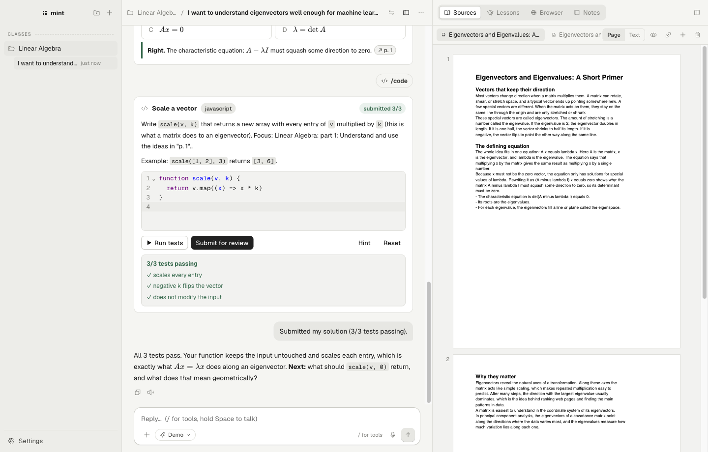
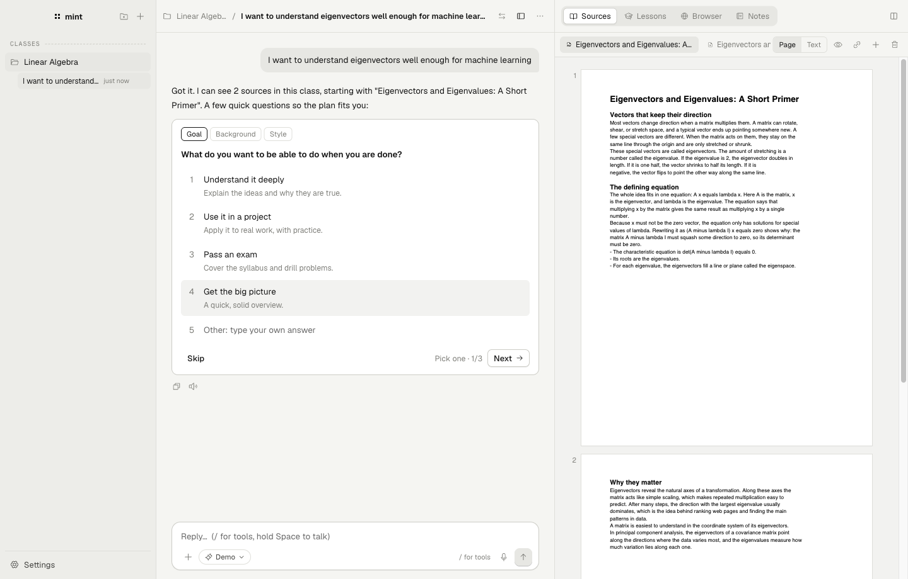
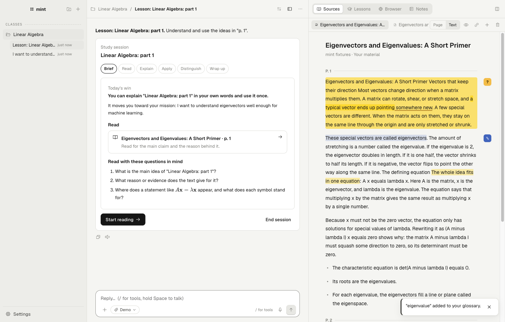
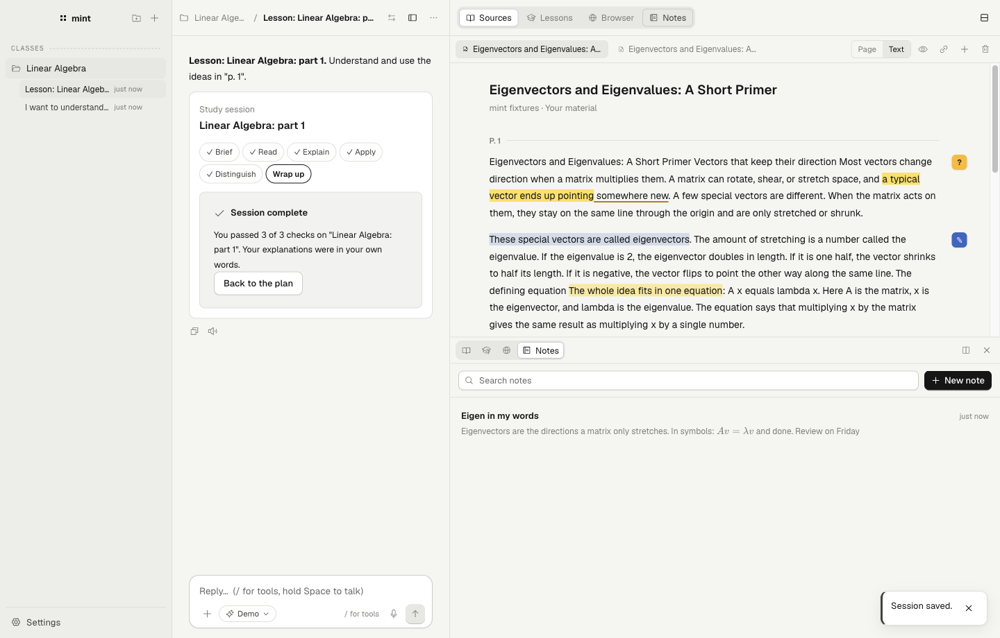
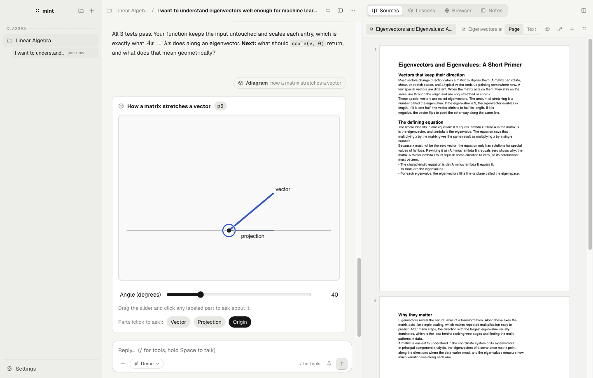

<p align="center">
  
</p>

<h1 align="center">mint</h1>

<p align="center">
  <b>An agent harness for self-study.</b><br />
  Bring your own books, papers and notes. The tutor plans, teaches and checks you, then steps back.<br />
  <i>The more you use mint, the less you need it.</i>
</p>

<p align="center">
  <a href="https://github.com/ketiyohannes/mint/releases">Download (macOS, Windows, Linux · alpha)</a> ·
  <a href="#how-it-works">How it works</a> ·
  <a href="#build-from-source">Build from source</a>
</p>



mint is laid out like the coding agents you already use (Claude Code, Codex, T3), but the project is a subject you are learning. Open a folder of materials and you get a class: a chat with a tutor, your sources open beside it, and a curriculum built from what you brought.

mint has no agent loop of its own. Every model turn runs in the **Claude Agent SDK** or the **Codex app-server**. mint owns everything around the turn: the curriculum, the lesson loop, how the tutor helps and your learning records. Code remembers; models judge.

## How it works

1. **Open a folder.** The folder button in the sidebar (hide it with ⌘B / Ctrl+B) turns a folder of PDFs, Markdown, Word files, web links or YouTube lectures into a class. No materials? mint searches trusted sites and imports only what you approve.
2. **Say what you want.** A new chat opens with the prompt in the middle. The tutor asks two to four quick multiple-choice questions (goal, background, time, style), like a coding agent clarifying a task, then posts a plan.
3. **Learn in the chat.** Quizzes, code exercises and diagrams appear as cards in the conversation; a lesson floats over the top of the chat. Type `/` for tools:

   | Tool | What it does |
   | --- | --- |
   | `/lesson [topic]` | A lesson that stays open over every chat of the class (fold it to one line with ⌘L, or put it in a Study tab in Settings): brief, read, explain, apply, distinguish, wrap up. Every tutor in the class sees the study box, including an answer you have not submitted yet, and Resume opens it in the chat you are in |
   | `/quiz [focus]` | Retrieval practice, graded, with explanations that cite your sources |
   | `/code [focus] [python\|js]` | A small IDE with tests that run offline (JavaScript, or Python via a local Pyodide) |
   | `/diagram <what>` | An interactive p5 or three.js diagram; click a part to ask about it |
   | `/plan [change]` | Re-plan the curriculum |

4. **Read the source.** The right panel holds your **Sources** (real PDF pages, with optional dark pages), **Lessons**, **Study** (the open lesson's brief and checks), a **Browser** for your own research, and **Notes**. Split it to see two at once, for example notes beside a paper; a lesson opens its reading beside the study box.
5. **Ask about anything.** Select a passage and choose **Chat** to quote it into the conversation, or **Side chat** to ask in a small floating window that stays out of the way.

<table>
  <tr>
    <td></td>
    <td></td>
  </tr>
  <tr>
    <td></td>
    <td></td>
  </tr>
</table>

## The teaching method

The tutor follows a modified version of [teach-skills](https://github.com/ketiyohannes/teach-skills) (itself based on Matt Pocock's `teach` skill), bundled at [`src/main/pedagogy/teach/SKILL.md`](src/main/pedagogy/teach/SKILL.md). Each tool loads the core rules plus only the sections it needs.

- **Your materials are the authority.** The tutor reads and cites them (citations jump to the exact quote on the page) and labels anything from outside them.
- **A tutor that teaches.** Ask about anything, from your materials or beyond them, and the tutor explains it in depth and in its own words: the intuition, each part of the definition, a worked example, and how it connects to what you know, with the passages it builds on cited as references. Prefer to work things out? Pick **Coach** in Settings for a help ladder instead: a pointer to the passage, then a guiding question, then a hint, and the full explanation only when you ask. On the ladder, help starts lower as you show independence.
- **Mastery, not coverage.** A topic counts as learned when you can explain it, apply it to a new case, and tell it apart from nearby ideas. Mastered topics come back as spaced reviews.
- **Records of what you know.** Learning records and a glossary hold only what you have shown you understand. They set what to teach next.

Every class is also a plain folder you own, in the `/teach` workspace format: `MISSION.md`, `CURRICULUM.md`, `RESOURCES.md`, `GLOSSARY.md`, `learning-records/`, `notes/` and `sources/`.

## Features

- **Rich rendering everywhere.** Markdown, LaTeX, code, and arrays or matrices as cells look the same in the chat, side chats, lesson briefs, checks and quizzes.
- **Notes.** A notepad with headings, lists and checklists, highlights, code, links and LaTeX formulas (type `$x^2$`). It saves as you type.
- **Layout.** Swap the chat and the panel, resize them, or split the panel into two tabs, side by side or stacked.
- **Keyboard first.** New chat, switch chats, show or hide the sidebar and the panel, run tests, check an answer, stop a reply: each has a shortcut, and **Settings → Keyboard shortcuts** lists them all. `/` goes to the prompt box from anywhere.
- **Nothing typed is lost.** Unsent messages, half-written check answers and exercise code are kept when you move around or restart. The reader reopens each source where you left it, and the Browser tab reopens its last page.
- **Focus timer.** A Pomodoro timer in the chat's header: focus blocks, short breaks, and a long break after every few blocks, with lengths you set. It keeps running across views and restarts, chimes and notifies when a block ends, and counts today's focused minutes.

## Install

Download the latest build from [Releases](https://github.com/ketiyohannes/mint/releases). These alphas are not yet signed by Apple or Microsoft, so each system asks once before the first launch.

| System | File | First launch |
| --- | --- | --- |
| macOS (Apple silicon) | `mint-…-mac-arm64.dmg` | Drag mint to Applications. Right-click it and choose **Open**, then **Open** again (or run `xattr -dr com.apple.quarantine /Applications/mint.app`). |
| Windows (x64) | `mint-…-win-x64-setup.exe` | If SmartScreen appears, choose **More info**, then **Run anyway**. A portable `.zip` is also attached. |
| Linux (x64) | `mint-…-linux-….deb` or `mint-…-linux-….AppImage` | `sudo apt install ./mint-….deb`, or `chmod +x mint-….AppImage` and run it. |

Then pick a harness in **Settings** and press **Test connection**:

- **Claude**: an Anthropic API key, entered in Settings. (A local Claude Code login also works for your own use; Anthropic asks third-party apps to use API keys.) The Claude agent is bundled with mint.
- **Codex**: the `codex` CLI installed and logged in (`codex login`).
- **Demo**: offline, scripted answers for exploring the app. No model is involved.

Choose the model from the pill in the prompt box (or in Settings). mint asks each harness which models it offers; each harness remembers its own choice, and it applies to every class.

**Updates.** From 0.1.0-alpha.4 on, mint checks GitHub for new releases and shows **Update mint** at the bottom of the sidebar. One click downloads the new version and checks it; **Restart to update** installs it (or it installs the next time mint quits). **Settings → Updates** shows your version and checks on demand. Updates install inside mint on every system and for every kind of copy; **What's new** in Settings shows the release notes. A copy opened straight from the disk image moves itself into Applications as it updates.

Your classes, notes and settings stay on your computer (on macOS, `~/Library/Application Support/mint`). API keys are encrypted with the system keychain.

## Build from source

Requires Node 22 or newer.

```bash
npm install
npm run dev          # development, with hot reload
npm run check        # typecheck and unit tests
npm run test:e2e     # builds, then drives the whole app with Playwright
npm run dist         # package for this system into dist/
```

A copy run from source keeps its own profile, so it never touches the classes in an installed mint. [CONTRIBUTING.md](CONTRIBUTING.md) covers the rest: profiles, debugging, the test flags, environment variables, how to add an API call, and releasing.

Releases are built by [`.github/workflows/release.yml`](.github/workflows/release.yml): `npm run release` tags a version, and the workflow builds macOS, Windows and Linux on their own runners, runs the end-to-end test against each packaged app, and uploads the installers and update feeds (`latest*.yml`) to the release. Installed copies pick the release up from there.

### Tests

The end-to-end test walks the whole product: opening a folder, the setup questions, the tutor's explanations and the Coach help ladder, side chats, quoting a passage into the chat, `/quiz`, a code exercise, a diagram, PDF highlights and notes, web search, a lesson to mastery, the notepad, the split panel, the trusted-source fallback and deleting a class. It fails on any console error.

## Architecture

```
src/main             Electron main process: owns all state
  agents/            AgentRuntime: claude.ts (Agent SDK), codex/ (app-server JSON-RPC), demo.ts
  jobs/              every prompt, zod schema and demo answer; format.ts is the shared formatting contract
  pedagogy/          the teach skill (mint edition) and its section loader
  learning/          deterministic rules: curriculum validation, mastery, reviews, independence
  services/          chat (intake, tools, widgets), classes, sources, sessions, threads, notebook, diagrams
  sources/           importers: PDF, HTML (Readability), Markdown, text, Word, YouTube
  store/             atomic JSON state, settings, keychain-encrypted secrets, /teach exports
  updater.ts         in-app updates from GitHub releases (electron-updater; on macOS a verified bundle swap)
src/preload          the only bridge: typed invoke channels and four event streams
src/renderer         React UI: chat and widgets, reader, panel, notes, popovers
                     (components/RichText.tsx is the one renderer for tutor text)
resources/diagram-sandbox   sandboxed runtimes for model-written diagrams and learner code
```

Guardrails:

- **Claude turns** get an explicit tool allowlist (read and search, plus web search only on trusted domains). A PreToolUse hook keeps file reads inside the class folder. Your own Claude Code settings, hooks and `CLAUDE.md` are not loaded.
- **Codex turns** run in an ephemeral read-only thread with approvals declined and web search limited to allowed domains.
- **Model output that changes state** is schema-validated, then checked again by code.
- **Diagram code and learner code** run in opaque-origin iframes with strict CSPs and no network. Learner code runs in workers that are stopped after a timeout.
- **The Browser tab** is a sandboxed `<webview>` with its own session and no permissions.

## Known limitations

- Builds are for Apple silicon Macs, Windows x64 and Linux x64. Each is tested end to end on CI, but Windows and Linux have had less hands-on use.
- On Linux, the AppImage may need `--no-sandbox` on systems that restrict unprivileged user namespaces; the `.deb` sets up Chromium's sandbox itself.
- Scanned PDFs show their pages but need OCR before you can select or ask about text.
- Codex runs with your `~/.codex` configuration, so your Codex hooks and MCP servers also run on mint's turns.

## Credits

- The teaching method builds on Matt Pocock's [`teach` skill](https://github.com/mattpocock/skills) (MIT) via [teach-skills](https://github.com/ketiyohannes/teach-skills).
- Icons by [Phosphor](https://phosphoricons.com); type set in [Geist](https://vercel.com/font).

## License

[MIT](LICENSE) © Keti Yohannes
